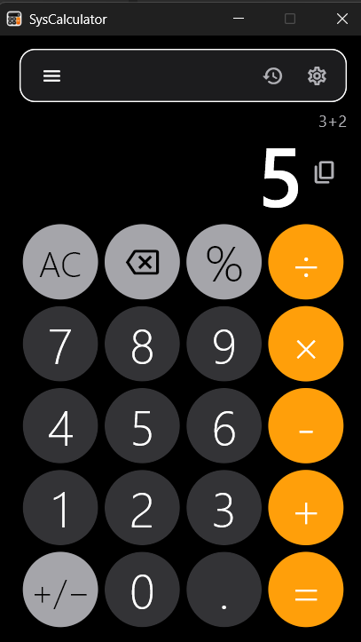

<h1 align="center">NumCals</h1>

<p align="center">
  A simple Windows calculator for everyday math, science, and currency
  conversion, with keyboard-friendly controls and light or dark themes.
</p>

<p align="center">
  
  <a href="https://github.com/Tenqo/NumCals/releases/latest">
    
  </a>
  <a href="LICENSE"></a>
</p>

<p align="center">
  <a href="#screenshots">Screenshots</a> ·
  <a href="#download">Download</a> ·
  <a href="#build">Build</a> ·
  <a href="#license">License</a>
</p>

## Screenshots

<table>
  <tr>
    <td align="center" width="50%">
      
      <br><strong>Basic math</strong>
      <br>Enter calculations with the keypad, keyboard, or number pad.
    </td>
    <td align="center" width="50%">
      
      <br><strong>Scientific mode</strong>
      <br>Use trigonometry, powers, roots, logarithms, and constants.
    </td>
  </tr>
  <tr>
    <td align="center" width="50%">
      
      <br><strong>Currency converter</strong>
      <br>Convert between currencies with the selected reference rate.
    </td>
    <td align="center" width="50%">
      
      <br><strong>Settings</strong>
      <br>Adjust appearance, check services, see shortcuts, and keep the app on top.
    </td>
  </tr>
</table>

## Features

- **Standard and scientific calculations:** work with parentheses, degrees or
  radians, trigonometric functions, powers, roots, logarithms, factorials, and
  constants. Standard mode keeps the everyday keypad close at hand.
- **Currency conversion:** uses daily reference rates from
  [Frankfurter](https://frankfurter.dev/). An internet connection is required;
  rates are reference values, not live market quotes.
- **Recent calculations:** revisit or reuse the last ten results in the current
  session. Copy results or enter calculations with the keyboard or number pad.
- **Settings:** choose System, Light, or Dark appearance; check whether the
  calculator and currency service are available; review keyboard shortcuts;
  and keep the calculator visible above other windows.

## Download

NumCals **1.0.2+3** is being validated on the `Windows_Tests` branch. This is
a test build, not a public GitHub Release. After the branch workflow succeeds,
download its seven-day artifact from the
[Windows test workflow](https://github.com/Tenqo/NumCals/actions/workflows/windows-tests.yml?query=branch%3AWindows_Tests).
The artifact contains the setup wizard, portable ZIP, PowerShell installer,
and SHA-256 manifest.

- `NumCals-Setup.exe` opens the setup wizard, where you can choose the
  install folder and whether to add a desktop shortcut.
- `NumCals-portable.zip` contains the portable app. Extract it and keep
  the files together.

The latest published release remains **v1.0.1**; its assets predate the NumCals
rename. The PowerShell one-line installer below will install NumCals after a
matching NumCals release is published. It is not a way to install the
`Windows_Tests` artifact:

  ```powershell
  irm https://raw.githubusercontent.com/Tenqo/NumCals/Windows_Tests/tooling/windows/Install-LatestRelease.ps1 | iex
  ```

  From Command Prompt, launch the same command through PowerShell:

  ```cmd
  powershell.exe -NoProfile -ExecutionPolicy Bypass -Command "irm 'https://raw.githubusercontent.com/Tenqo/NumCals/Windows_Tests/tooling/windows/Install-LatestRelease.ps1' | iex"
  ```

These commands run the installer directly from the repository. Use them only
if you trust the script source. Once installed, the final prompt accepts
`NumCals update`, `NumCals upgrade`, `NumCals remove`, or `NumCals help`.

## Build

Install Flutter stable and Visual Studio's **Desktop development with C++**
workload, then run these commands from the project folder:

```powershell
flutter pub get
flutter test
flutter run -d windows
```

The Windows build is named `NumCals.exe` and is written to
`build\windows\x64\runner\Release\`. Launch it from PowerShell with
`.\build\windows\x64\runner\Release\NumCals.exe`, or from Command Prompt with
`build\windows\x64\runner\Release\NumCals.exe`.

## License

GPL-3.0-only. See [LICENSE](LICENSE).
