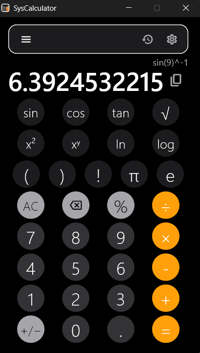
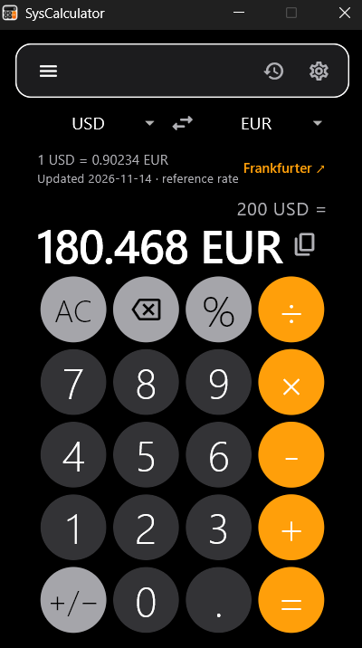
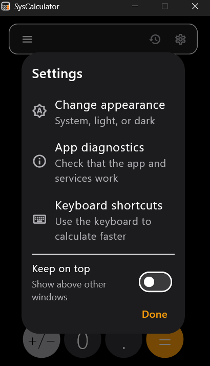

<h1 align="center">NumCals</h1>

<p align="center">A focused Windows calculator for math, science, and currency conversion.</p>

<p align="center">
  
  <a href="https://github.com/Tenqo/NumCals/releases/latest">
    
  </a>
  <a href="LICENSE">
    
  </a>
</p>

<p align="center">
  <a href="#screenshots">Screenshots</a> ·
  <a href="#features">Features</a> ·
  <a href="#download">Download</a> ·
  <a href="#build">Build</a> ·
  <a href="#license">License</a>
</p>

## Screenshots

<p align="center">
  
</p>
<p align="center"><em>Standard calculator</em></p>

<details>
  <summary>More screenshots</summary>
  <p align="center">
    
    
    
  </p>
</details>

## Features

- **Standard and scientific calculations** — Parentheses, trigonometry, powers,
  roots, logarithms, factorials, and constants.
- **Currency conversion** — Daily reference rates from
  [Frankfurter](https://frankfurter.dev/); an internet connection is required.
- **History and keyboard support** — Revisit the last ten results, copy values,
  or enter calculations using the keyboard or number pad.
- **Appearance and settings** — Choose System, Light, or Dark themes; check
  service status, review shortcuts, and keep the app on top.

## Download

**NumCals 1.0.2+3 is being validated on `Windows_Tests`. It is not a public
GitHub Release.** The latest successful workflow run provides a seven-day test
artifact at the [Windows test workflow](https://github.com/Tenqo/NumCals/actions/workflows/windows-tests.yml?query=branch%3AWindows_Tests).

- `NumCals-Setup.exe` — Setup wizard with install-location and shortcut options.
- `NumCals-portable.zip` — Portable app; extract the ZIP and keep its files together.

The latest published release is still **v1.0.1**; its assets predate the NumCals
rename. See [GitHub Releases](https://github.com/Tenqo/NumCals/releases/latest).

<details>
  <summary>PowerShell installer commands (for a matching NumCals release)</summary>

  These commands install the latest published release, not the
  `Windows_Tests` artifact. Use them after a matching NumCals release is
  available.

  **PowerShell**

  ```powershell
  irm https://raw.githubusercontent.com/Tenqo/NumCals/Windows_Tests/tooling/windows/Install-LatestRelease.ps1 | iex
  ```

  **Command Prompt**

  ```cmd
  powershell.exe -NoProfile -ExecutionPolicy Bypass -Command "irm 'https://raw.githubusercontent.com/Tenqo/NumCals/Windows_Tests/tooling/windows/Install-LatestRelease.ps1' | iex"
  ```
</details>

## Build

Requires Flutter stable and Visual Studio's **Desktop development with C++**
workload.

```powershell
flutter pub get
flutter test
flutter run -d windows
```

**Windows executable:** `build\windows\x64\runner\Release\NumCals.exe`

## License

GPL-3.0-only. See [LICENSE](LICENSE).
